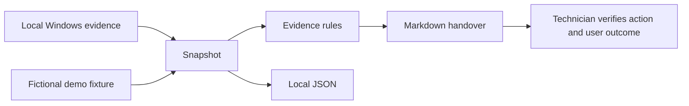

# Windows Support Triage

A read-only PowerShell tool for investigating Windows device problems and writing
support handovers. It collects system disk space, restart indicators, Print
Spooler state and recent error metadata. Findings suggest the next check.

## Try a support case

Requires PowerShell 7.4 or newer. The demo works on Windows, macOS and Linux.
It uses fictional fixtures and does not inspect or change the computer.

```powershell
pwsh ./scripts/Invoke-EndpointTriage.ps1 -Demo printing -CaseReference LAB-1001
```

Open `reports/LAB-1001.md` for the handover and `reports/LAB-1001.json` for the
snapshot. Other examples are `low-disk`, `healthy` and `unavailable`. Choose a
new case reference for each run. Existing case files are protected from overwrite.

See the [sample report](examples/printing-report.md) and
[first exercise](docs/first-exercise.md).

## Inspect an authorised Windows device

Run this locally on the affected Windows computer, using the organisation's
approved support process. Start with a normal user session. Some reads may be
unavailable without suitable access. The tool records that as unknown.

```powershell
pwsh ./scripts/Invoke-EndpointTriage.ps1 -Live -Symptom Printing -CaseReference INC-1001
```

Use `General` or `Performance` when appropriate. Spooler collection only runs
for a printing symptom. No service is started, restarted or enabled.

## How it works



| Check | Evidence | Interpretation |
| --- | --- | --- |
| Operating system | Version and last boot | Context, not a diagnosis |
| System disk | Capacity and free bytes | Attention below 10 GiB or 10 percent |
| Restart indicators | Three limited registry indicators | A restart may be outstanding |
| Print Spooler | Service state and start type | Investigate if stopped and printing is expected |
| System and Application logs | Up to 20 critical/error records per log over 24 hours | Correlate times and providers with the user's fault |
| Unavailable collection | Check name and exception type | Unknown, never a healthy result |

The disk thresholds are lab heuristics, not Microsoft minimum requirements.
Event results are a bounded sample. They are not a complete event count.
Restart indicators do not establish update compliance.

## What this demonstrates

Windows troubleshooting, PowerShell, exception handling, structured evidence,
incident handovers, test cases and cautious interpretation of incomplete data.
The [case runbooks](docs/support-cases.md) show how to scope an incident, agree a
repair, retest with the user and escalate with useful notes.

This complements [Azure Service Desk Toolkit](https://github.com/Pantelovich/azure-service-desk-toolkit),
which collects Microsoft 365 tenant evidence. This project does not connect to
Graph or require Azure credit, a tenant or an Intune licence.

## Checks

Install Pester and PSScriptAnalyzer in a development PowerShell session.
The collector itself needs no extra modules.

```powershell
Install-Module Pester -RequiredVersion 5.7.1 -Scope CurrentUser
Install-Module PSScriptAnalyzer -RequiredVersion 1.24.0 -Scope CurrentUser
pwsh ./scripts/Test-Project.ps1
```

On Windows, add `-WindowsSmoke` to exercise the live collector. GitHub Actions
runs checks on Windows and Linux. A hosted Windows runner checks Windows APIs,
not a physical printer or a Windows 11 employee laptop. See
[validation](docs/validation.md) for what has actually been run.

## Data handling and limits

Collection selects fields explicitly. It excludes usernames, hostnames, serial
numbers, full event messages and file paths from restart entries. It does not
upload anything. Live reports remain local and are ignored by Git. Review them
before placing them in an approved ticket system.

This is an endpoint triage lab. It does not test sign-in, account permissions,
domain trust, Intune compliance, installed patch compliance or network connectivity.
It does not prove a reported problem is resolved. The technician records the
approved action and user verification separately.

## Project files

| Path | Purpose |
| --- | --- |
| `src/` | Collector, evidence rules and report formatter |
| `scripts/Invoke-EndpointTriage.ps1` | Demo or live command and local output |
| `tests/` | Repeatable finding and output checks |
| `examples/` | Fictional snapshots and sample report |
| `docs/` | Runbooks, interview explanation and design decisions |

## Next improvements

Validate on an authorised Windows 11 VM and a physical printer. Then consider
printer queue evidence and a before/after comparison. Add collection only when
it helps answer a defined support question.

MIT licensed.

